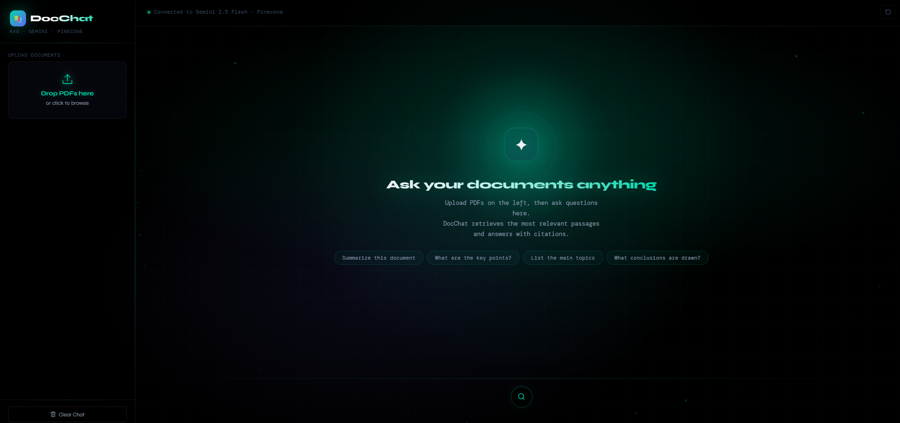
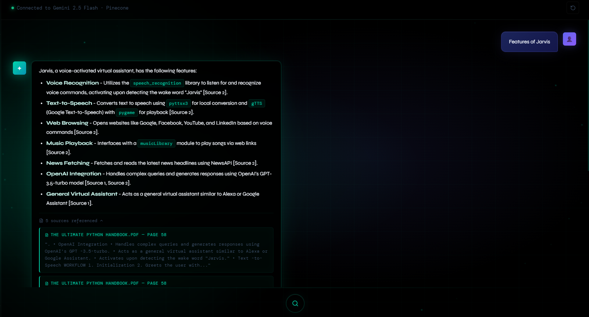

# DocsAnalyser — AI-Powered PDF Assistant

DocsAnalyser is a full-stack AI-powered document analysis application that allows users to upload PDF documents and ask questions in natural language. It uses Retrieval-Augmented Generation (RAG) to retrieve relevant information and generate context-aware answers with source citations.

Built using **React, FastAPI, Google Gemini, and Pinecone**.


---

## 🚀 Demo Preview

### Homepage & PDF Upload


### AI Responses with Source Citations


---

## ✨ Features

- Upload PDF documents through an interactive web interface.
- Extract and process PDF content automatically.
- Convert document text into semantic embeddings using Gemini.
- Store and retrieve document vectors using Pinecone.
- Ask questions in natural language.
- Generate context-aware answers using Gemini 2.5 Flash.
- Display source references to help verify answers.
- Support follow-up questions through conversation history.

## 🎯 Use Cases

- Analyse resumes and professional documents.
- Understand research papers and technical documents.
- Extract important information from study materials.
- Ask questions about lengthy PDF files.
- Quickly search and understand document content.

---

## 🧠 System Architecture

```text
             React Frontend
                   |
             HTTP Requests
                   |
             FastAPI Backend
                   |
               RAG Engine
                   |
          PDF Text Extraction
                   |
          Text Chunk Processing
                   |
          Gemini Embeddings
                   |
           Pinecone Vector DB
                   |
           Similarity Search
                   |
          Gemini 2.5 Flash
                   |
          AI Answer + Sources
                   |
             React Frontend
```

### How It Works

1. The user uploads a PDF document.
2. The backend extracts text from the PDF.
3. LangChain splits the extracted text into smaller chunks.
4. Gemini converts the chunks into numerical embeddings.
5. Pinecone stores the embeddings and associated metadata.
6. When a question is asked, it is converted into an embedding.
7. Pinecone retrieves the most relevant document chunks.
8. Gemini generates an answer using the retrieved context.
9. The frontend displays the answer and its sources.

---

## 🛠️ Technology Stack

### Frontend
- React 18
- Vite
- JavaScript
- Axios
- Lucide React
- Custom CSS

### Backend
- Python
- FastAPI
- Uvicorn
- LangChain
- pypdf

### AI & Database
- Google Gemini Embedding API
- Gemini 2.5 Flash
- Pinecone Vector Database

---

## 📁 Project Structure

```text
DocsAnalyser/
│
├── assets/
│
├── backend/
│   ├── main.py
│   ├── chat.py
│   ├── rag_engine.py
│   ├── requirements.txt
│   ├── .env.example
│   └── .env
│
├── frontend/
│   ├── src/
│   │   ├── components/
│   │   ├── App.jsx
│   │   ├── api.js
│   │   ├── main.jsx
│   │   └── index.css
│   ├── index.html
│   ├── package.json
│   └── vite.config.js
│
└── README.md
```

---

## ⚙️ Getting Started

### Prerequisites

- Python 3.12
- Node.js and npm
- Google Gemini API key
- Pinecone API key

Get your API keys:

- [Google AI Studio](https://aistudio.google.com/app/apikey)
- [Pinecone](https://app.pinecone.io/)

### 1. Clone the Repository

```bash
git clone https://github.com/udaye-gwd/DocsAnalyser.git
cd DocsAnalyser
```

### 2. Configure the Backend

```powershell
cd backend
py -3.12 -m venv .venv
.\.venv\Scripts\Activate.ps1
python -m pip install --upgrade pip
pip install -r requirements.txt
```

### 3. Configure Environment Variables

Create a `.env` file inside the `backend` folder.

```env
GEMINI_API_KEY=your_gemini_api_key
PINECONE_API_KEY=your_pinecone_api_key
PINECONE_INDEX_NAME=doc-chatbot
```

Add your actual API keys before starting the application.

### 4. Start the Backend

From the `backend` folder, run:

```powershell
python -m uvicorn main:app --reload
```

Backend URL: `http://127.0.0.1:8000`

API documentation: `http://127.0.0.1:8000/docs`

### 5. Start the Frontend

Open a second terminal:

```powershell
cd frontend
npm install
npm run dev
```

Frontend URL: `http://localhost:5173`

Open the frontend URL in your browser to use DocsAnalyser.

---

## 📡 API Endpoints

| Method | Endpoint | Description |
|---|---|---|
| GET | `/` | Backend status |
| GET | `/health` | Health check |
| POST | `/upload` | Upload and index a PDF |
| POST | `/query` | Ask questions about documents |

---

## 🔐 Environment Variables

| Variable | Description |
|---|---|
| `GEMINI_API_KEY` | Google Gemini API key |
| `PINECONE_API_KEY` | Pinecone API key |
| `PINECONE_INDEX_NAME` | Pinecone index name |

**Security:** Never upload your `.env` file or expose API keys publicly.

---

## 👨‍💻 Developer

**Uday Kiran**

GitHub: [udaye-gwd](https://github.com/udaye-gwd)

Project: [DocsAnalyser](https://github.com/udaye-gwd/DocsAnalyser)

---

*DocsAnalyser — Making document understanding smarter with AI.*
